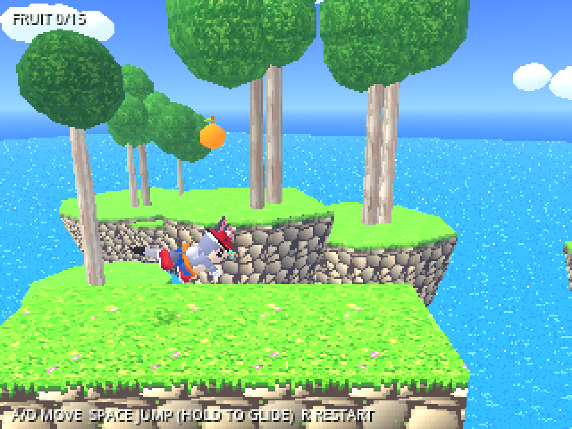
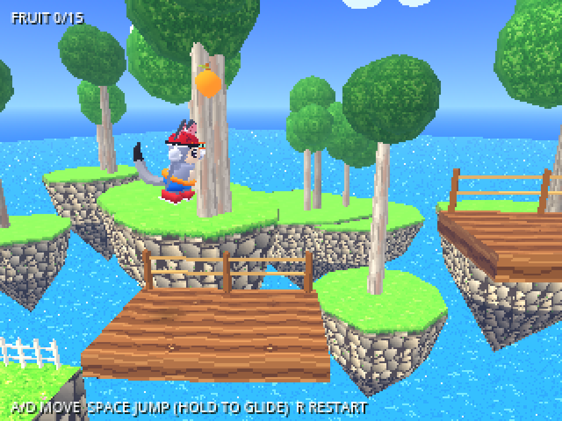

# Bao: Legend of the Dragonfruit

A 2.5D platformer starring **Bao**, the sugar glider from *Super Snowboarding!*, built in **Godot 4.7**.

As Bao, you run, jump and glide along a winding path across sunny floating islands high above the sea. The path curves through 3D space while the controls stay 2D, and the camera swings round with it.





## Features

- **Path-based 2.5D movement.** Bao moves along a curved path (offset) and up/down (height), and the level turns those into a 3D position.
- **Gliding.** Hold jump in the air to spread your flaps and glide. You get about 2.4 seconds per jump, refilled on landing.
- **Updrafts.** Rising air lifts you while gliding and doesn't use up glide time.
- **Solid ground and one-way branches.** Bump into ground blocks; jump up through branches from below.
- **Fruit, checkpoints and a goal tree.**
- **PS1-style look.** Vertex-snapped, per-vertex-lit shaders and chunky low-poly scenery.
- **Hand-keyed animations** made in Blender: idle, run, jump, fall and glide.

## Controls

| Action | Keyboard | Gamepad |
| --- | --- | --- |
| Move | A / D or arrow keys | Left stick / D-pad |
| Jump (hold in the air to glide) | Space, Z, W or Up | A |
| Restart | R | Y |

## Running it

1. Install [Godot 4.7](https://godotengine.org/).
2. In the Project Manager, click **Import** and choose this folder's `project.godot`.
3. Press **F5**.

## Project layout

```
assets/models/          sugar_glider.glb (exported from Blender)
assets/models/source/   sugar_glider.blend and textures (ignored by Godot)
assets/textures/source/ level textures (.aseprite to edit, .png used by the game)
tools/aseprite/         Lua scripts that generate the textures with Aseprite
scenes/main.tscn        the test level
scripts/level.gd        path maths, collision queries and level layout
scripts/player.gd       Bao's movement, gliding and animation
scripts/path_camera.gd  side-on camera that follows the path
scripts/input_setup.gd  keyboard and gamepad bindings
scripts/mesh_util.gd    low-poly mesh helpers and PS1 materials
shaders/                PS1-style shaders
```

## Editing the level

The level is defined by the lists at the top of `scripts/level.gd`. Positions are given as an **offset** (metres along the path) and a **height**:

- `PLATFORMS`: `[start, end, top height, solid]`
- `FRUIT`: `[offset, height above the ground]`
- `UPDRAFTS`: `[start, end, lift speed]`
- `CHECKPOINTS` and `GOAL_OFFSET`

## Textures

The level's 32x32 pixel-art textures are generated by Aseprite scripts in `tools/aseprite/` and can be touched up by hand in the `.aseprite` files (then **File > Export As** the `.png`). To regenerate them:

```
Aseprite.exe -b --script-param dir=<path to assets/textures/source> --script tools/aseprite/bright_textures.lua
Aseprite.exe -b --script-param dir=<path to assets/textures/source> --script tools/aseprite/level_textures.lua
```

`bright_textures.lua` makes the grass, grass edge, stone cliff, water and leaves; `level_textures.lua` makes the wood and gum bark.

## Animations

Animations live in `assets/models/source/sugar_glider.blend` as Blender actions (`idle`, `run`, `jump`, `fall`, `glide`). Re-export to `assets/models/sugar_glider.glb` with **glTF Binary**, **Selected Objects** (`GliderRig` and `SugarGliderRider`) and **Animation mode: Actions**.
